# Laboratório - Captura de tráfego em nuvem com Packet Mirroring (Google Cloud)

Laboratório prático de **espelhamento de pacotes (Packet Mirroring)** no Google Cloud Platform: o tráfego de uma VM de origem (`sourcevm`) é copiado, via um balanceador de carga interno UDP, para uma VM coletora (`targetvm`), onde é capturado com `tcpdump` e analisado no Wireshark.

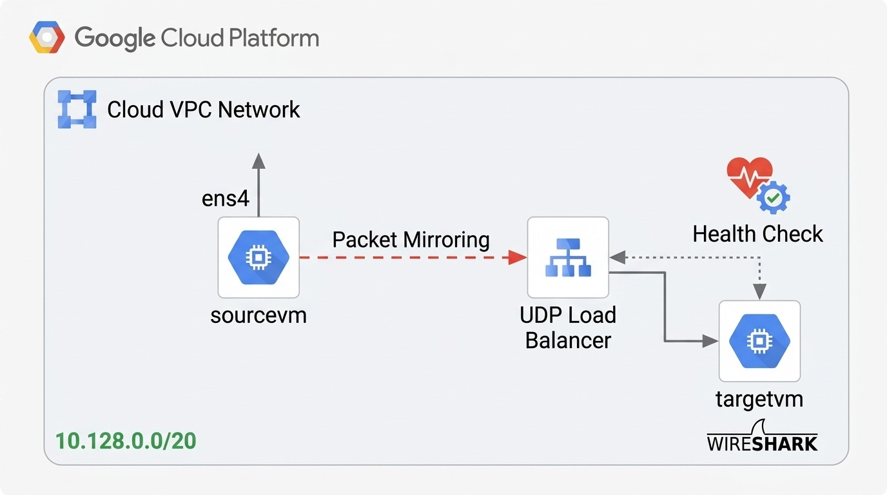

> Diagrama ilustrativo gerado com IA. A sub-rede usada de fato é `10.128.0.0/20` (ver [Rede](#1-rede)).

## Sumário

- [Objetivo](#objetivo)
- [Ambiente](#ambiente)
- [1. Rede](#1-rede)
- [2. Instâncias](#2-instâncias)
- [3. Grupo de instâncias](#3-grupo-de-instâncias)
- [4. Balanceador de carga](#4-balanceador-de-carga)
- [5. Health check](#5-health-check)
- [6. Política de espelhamento](#6-política-de-espelhamento)
- [7. Teste de captura](#7-teste-de-captura)
- [8. Análise no Wireshark](#8-análise-no-wireshark)
- [Conclusão](#conclusão)
- [Estrutura do repositório](#estrutura-do-repositório)

## Objetivo

O Packet Mirroring do GCP clona o tráfego de instâncias selecionadas em uma VPC e o encaminha a um coletor, sem precisar instalar agentes nas VMs monitoradas. É usado para monitoramento de segurança (IDS, análise forense) e diagnóstico de desempenho de aplicações.

Neste lab, o objetivo é:

1. Espelhar todo o tráfego IPv4 da `sourcevm`;
2. Entregá-lo à `targetvm` por meio de um balanceador de carga interno com espelhamento habilitado;
3. Comprovar o espelhamento gerando tráfego ICMP na origem e capturando-o no coletor.

## Ambiente

| Item | Valor |
| --- | --- |
| Provedor | Google Cloud Platform |
| Região / zona | `us-central1` (Iowa) / `us-central1-a` |
| Tipo de máquina | `e2-micro` (2 vCPU compartilhadas, 1 GB RAM) |
| Sistema operacional | Ubuntu 24.04 LTS |
| Ferramentas | `tcpdump`, Wireshark |

## 1. Rede

Foi utilizada a VPC `default`.

| Parâmetro | Valor |
| --- | --- |
| Nome | `default` |
| Sub-redes | 42 (modo automático) |
| MTU | 1460 |

**Sub-rede utilizada**

| Parâmetro | Valor |
| --- | --- |
| Região | `us-central1` |
| Tipo de pilha de IP | IPv4 (pilha única) |
| Intervalo IPv4 principal | `10.128.0.0/20` |
| Gateway | `10.128.0.1` |

**Regra de firewall**

| Parâmetro | Valor |
| --- | --- |
| Nome | `default-allow-internal` |
| Direção | Entrada |
| Destinos | Todas as instâncias |
| Filtro de origem | `10.128.0.0/9` |
| Protocolos | `tcp:0-65535`, `udp:0-65535`, `icmp` |
| Ação | Permitir |
| Prioridade | 65534 |

## 2. Instâncias

### sourcevm (origem do tráfego)

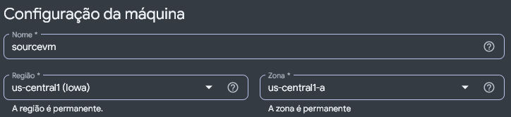

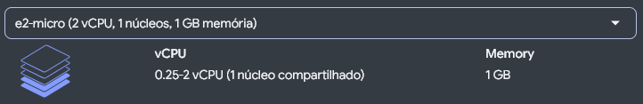

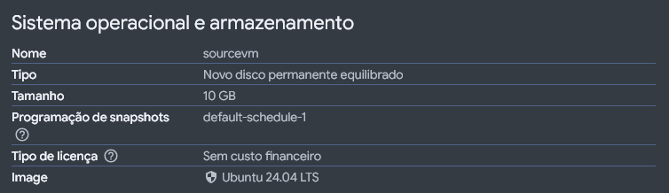

| Parâmetro | Valor |
| --- | --- |
| IP interno | `10.128.0.2` |
| IP externo | Efêmero |

### targetvm (coletor)

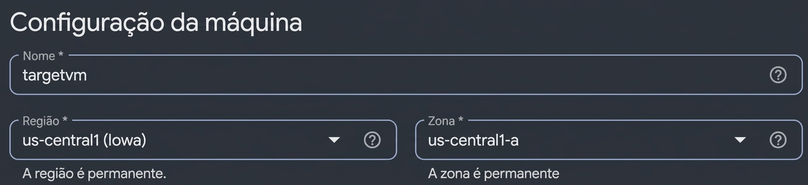


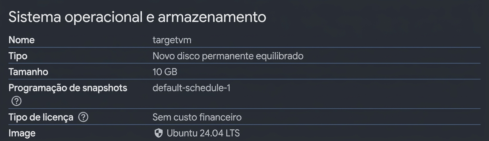

| Parâmetro | Valor |
| --- | --- |
| IP interno | `10.128.0.3` |
| IP externo | Efêmero |

## 3. Grupo de instâncias

O balanceador de carga exige um back-end; por isso a `targetvm` foi colocada em um grupo de instâncias não gerenciado.

| Parâmetro | Valor |
| --- | --- |
| Nome | `ig-target-wireshark` |
| Rede | `default` |
| Zona | `us-central1-a` |
| Instâncias | 1 (`targetvm`) |

## 4. Balanceador de carga

O coletor de Packet Mirroring precisa ser um **balanceador de carga de rede de passagem interno (Internal passthrough Network Load Balancer)** com a opção de espelhamento habilitada. As escolhas feitas no assistente foram:

| Etapa | Escolha | Tela |
| --- | --- | --- |
| Tipo | Balanceador de carga de rede | 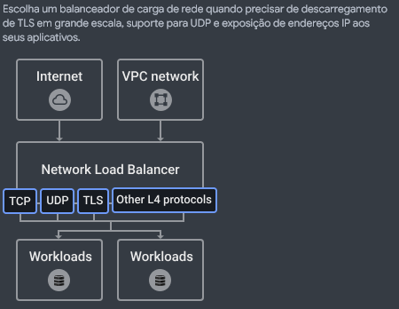 |
| Modo | Passagem (passthrough) - preserva o IP de origem | 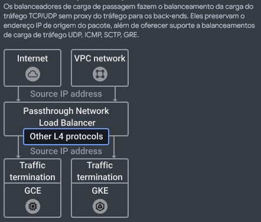 |
| Exposição | Interno | 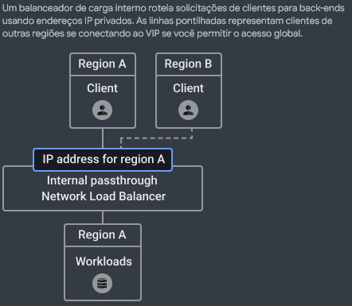 |

**Configuração geral**

| Parâmetro | Valor |
| --- | --- |
| Nome | `lb-espelhamento-udp` |
| Região | `us-central1` (Iowa) |
| Rede | `default` |

**Back-end**

| Parâmetro | Valor |
| --- | --- |
| Tipo de back-end | Grupo de instâncias |
| Grupo de instâncias | `ig-target-wireshark` |
| Protocolo | UDP |
| Health check | `hc-ssh` |
| Pilha de IP | IPv4 (pilha única) |

**Front-end**

| Parâmetro | Valor |
| --- | --- |
| Nome | `fe-coletor` |
| Protocolo | UDP |
| Versão do IP | IPv4 |
| Sub-rede | `default` |
| Finalidade do IP interno | Não compartilhado |
| Endereço IP | Efêmero |
| Portas | Todas |
| Acesso global | Desativado |

Por fim, o balanceador foi marcado como destino de espelhamento:

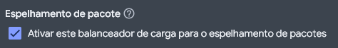

## 5. Health check

Health check `hc-ssh`, regional, verificando a porta TCP 22 (SSH) da `targetvm`.

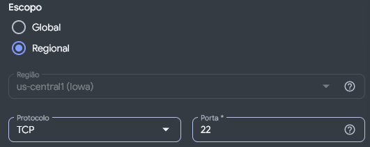

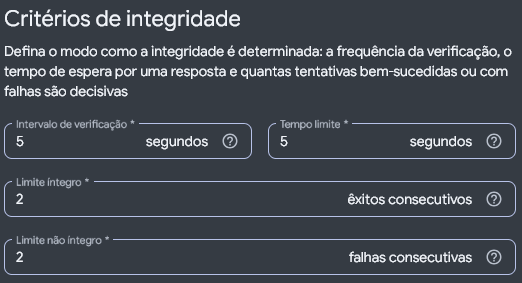

| Parâmetro | Valor |
| --- | --- |
| Escopo | Regional (`us-central1`) |
| Protocolo / porta | TCP / 22 |
| Intervalo de verificação | 5 s |
| Tempo limite | 5 s |
| Limite íntegro | 2 êxitos consecutivos |
| Limite não íntegro | 2 falhas consecutivas |

## 6. Política de espelhamento

| Parâmetro | Valor |
| --- | --- |
| Nome | `politica-lab-wireshark` |
| Região | `us-central1` (Iowa) |
| Rede | `default` |
| Origem espelhada | Instância individual (`sourcevm`) |
| Destino do coletor | `fe-coletor` |
| Tráfego espelhado | Todo (IPv4) |

## 7. Teste de captura

Na `sourcevm`, foram enviados 5 pings para `8.8.8.8`:

```bash
ping -c 5 8.8.8.8
```

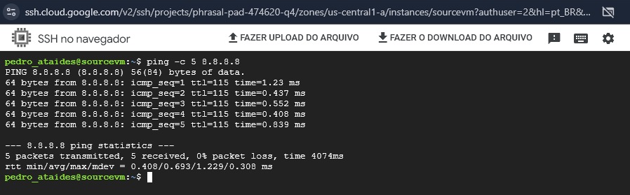

Na `targetvm`, a captura foi feita com:

```bash
sudo tcpdump -i any icmp -w captura-gcp.pcap   # gravar em arquivo
sudo tcpdump -i any icmp                       # visualizar em tempo real
```

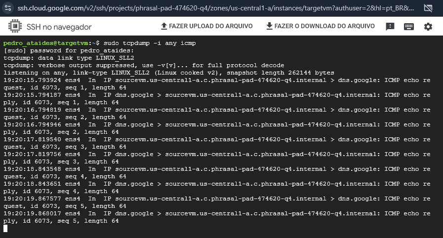

Os pacotes de *echo request* e *echo reply* trocados entre `sourcevm` e `dns.google` (8.8.8.8) aparecem na interface `ens4` da `targetvm`, embora a `targetvm` não participe dessa comunicação - isso confirma que o espelhamento funcionou.

## 8. Análise no Wireshark

O arquivo [`captures/captura-gcp.pcap`](captures/captura-gcp.pcap) pode ser aberto diretamente no Wireshark (filtro de exibição: `icmp`).

| Item | Resultado |
| --- | --- |
| Total de pacotes | 10 (5 *echo request* + 5 *echo reply*) |
| Origem / destino | `10.128.0.2` (sourcevm) ↔ `8.8.8.8` |
| TTL das requisições | 64 (valor inicial padrão do Linux) |
| TTL das respostas | 115 |
| Tipo de link | Linux cooked capture v2 (SLL2), por causa de `-i any` |

Observações:

- Os pacotes chegam ao coletor **sem encapsulamento** e com os IPs originais preservados - característica do Packet Mirroring do GCP, ao contrário de soluções que usam túnel (VXLAN/GRE).
- Todos os pacotes aparecem como `In` na `targetvm`, inclusive as requisições que saíram da `sourcevm`: o coletor recebe as cópias dos dois sentidos do fluxo.

## Conclusão

O laboratório mostrou como montar uma arquitetura de monitoramento passivo na nuvem com recursos nativos do GCP (VPC, grupo de instâncias, balanceador interno, health check e política de espelhamento). Com isso, é possível inspecionar o tráfego de uma VM sem alterá-la e sem instalar agentes, base para cenários de IDS, *threat hunting* e troubleshooting de rede.

> **Custos:** após o lab, exclui a política de espelhamento, a regra de encaminhamento/LB, o serviço de back-end, o health check, o grupo de instâncias e as VMs, nessa ordem.

## Estrutura do repositório

```
.
├── README.md
├── captures/
│   └── captura-gcp.pcap
└── images/
    ├── 00-topologia.jpg
    ├── 01-sourcevm-maquina.png
    ├── ...
    └── 11-teste-tcpdump-targetvm.png
```
